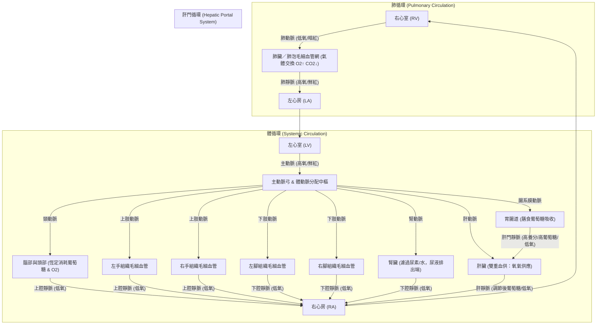
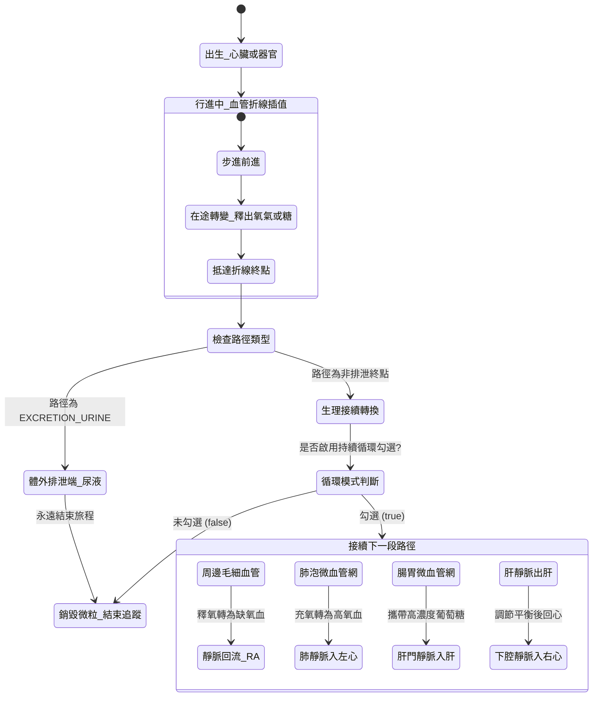

# 人體全方位循環與物質運輸模擬系統 技術規格書 (Technical Specification)

> **版本**：v1.0.0  
> **系統名稱**：Human Comprehensive Circulatory & Metabolism Simulator (體循環・肺循環・肝門循環)  
> **參考實作基礎**：`cholesterol_bile_acid_simulator` 現代化純前端 HTML5 Canvas 隔室動力學微粒架構  
> **適用領域**：醫學人體生理學、中學生物進階教學、互動科普展演

---

## 1. 系統概述與設計哲學 (System Overview)

本規格書將現有「膽固醇與膽汁酸腸肝循環模擬器」之成熟底層架構（**隔室常微分方程 ODE、雙層載體與物質微粒系統、折線平滑內插路徑、動態聲納準心追蹤、雙軌終點循環控制、折疊式高對比教學面板**）進行逆向工程，並針對「**人體體循環、肺循環、肝門循環、左右四肢、腦部、內臟，以及含氧量 (O₂/CO₂)、葡萄糖、紅血球 (RBC) 代謝運送**」進行全方位擴展與規格化設計。



### 1.1 核心架構特色
1. **純前端零依賴架構**：單一 HTML5 文件或模組化 ES6，內建自適應 Canvas 2D 向量繪圖引擎，支援 4K 投影與行動裝置 Retina 雙倍解析度（DPR 自適應）。
2. **隔室質量守恆模型 (Mass Conservation)**：紅血球數量、血容量、氧氣結合常數、葡萄糖總量維持動態連續平衡，徹底根絕數值發散漂移。
3. **雙層微粒與載體系統 (Carriers & Cargos)**：
   - 脂質微粒 → 升級為 **雙凹圓盤紅血球 (RBC)** 載體，內部攜帶血紅素結合氧氣（高氧飽和鮮紅 vs 低氧暗紅/紫色）。
   - 水溶性分子（**葡萄糖分子、尿素代謝物**）可自由溶解於血漿或由載體運載。
4. **教學專用追蹤與鎖定系統**：支援全圖隨機微粒或點選鎖定，具備動態雷達脈衝波、準心刻度、彗星拖尾光束，以及「**除排泄端外持續循環**」雙軌終點控制。

---

## 2. 畫布幾何與解剖節點拓撲 (Anatomical Nodes Specification)

系統採用邏輯座標系 `1600 × 900` 設計，中心為心臟與大血管，上方為腦部與雙手，兩側為肺臟，下方為腹腔內臟、肝門系統及雙腳。

```
                    ┌─────────────────────────┐
                    │    腦部與頭部 (BRAIN)    │
                    └───────────┬─────────────┘
          ┌─────────────┐       │       ┌─────────────┐
          │ 左手 (ARM_L) │       │       │ 右手 (ARM_R) │
          └──────┬──────┘       │       └──────┬──────┘
                 │       ┌──────┴──────┐       │
  ┌──────────────┼───────┤ 肺臟 (LUNGS) ├───────┼──────────────┐
  │              │       └──────┬──────┘       │              │
  │              │      ┌───────┴───────┐      │              │
  │              └─────►│  心臟 (HEART) │◄─────┘              │
  │                     │  RA RV LA LV  │                     │
  │                     └───────┬───────┘                     │
  │                             │ (主動脈降支)                 │
  │              ┌──────────────┴──────────────┐              │
  │       ┌──────┴──────┐               ┌──────┴──────┐       │
  │       │ 肝臟 (LIVER) │◄─(肝門靜脈)───┤ 胃腸 (GUT)  │       │
  │       └──────┬──────┘               └──────┬──────┘       │
  │              │ (肝靜脈)                     │             │
  │       ┌──────┴──────┐                      │             │
  │       │ 腎臟 (KIDNEY│                      │             │
  │       └───┬─────┬───┘                      │             │
  │           │     └─► 尿液排泄端 (URINE_END)  │             │
  │           │                                │             │
  │    ┌──────┴──────┐                  ┌──────┴──────┐      │
  │    │ 左腳 (LEG_L) │                  │ 右腳 (LEG_R) │      │
  │    └─────────────┘                  └─────────────┘      │
```

### 2.1 解剖節點幾何與參數清單

| 節點 ID | 中文名稱 | 邏輯座標 `(x, y)` | 尺寸 `(w, h)` | 邊框與底色標註 | 內部即時監控小量表 (Mini-bars) |
| :--- | :--- | :--- | :--- | :--- | :--- |
| `HEART` | 心臟 (四腔室+瓣膜) | `(800, 340)` | `280 × 160` | 紅粉高對比 `#831843` / `#f43f5e` | 心輸出量 (CO)、心搏率 (BPM) |
| `LUNGS` | 肺臟／肺泡微血管網 | `(800, 150)` | `320 × 100` | 亮青／海藍 `#083344` / `#06b6d4` | 肺泡 O₂ 分壓、CO₂ 排出相對速率 |
| `BRAIN` | 腦部與頭部微血管 | `(800, 42)` | `220 × 60` | 柔紫／靛藍 `#1e1b4b` / `#818cf8` | 腦組織氧飽和度、葡萄糖消耗率 |
| `ARM_L` | 左手組織毛細血管 | `(320, 240)` | `170 × 85` | 絳紅／暗紫 `#3b0764` / `#a855f7` | 上肢肌肉代謝率、耗氧程度 |
| `ARM_R` | 右手組織毛細血管 | `(1280, 240)` | `170 × 85` | 絳紅／暗紫 `#3b0764` / `#a855f7` | 上肢肌肉代謝率、耗氧程度 |
| `GUT` | 胃腸道 (吸收端) | `(1120, 520)` | `220 × 95` | 暖黃／琥珀 `#451a03` / `#f59e0b` | 膳食葡萄糖吸收通量、血流分配 |
| `LIVER` | 肝臟 (代謝與儲存) | `(800, 520)` | `250 × 110` | 磚紅／澄橘 `#7c2d12` / `#f97316` | 肝糖儲量 (Glycogen)、葡萄糖淨釋出 |
| `KIDNEY`| 腎臟 (排泄調控) | `(520, 520)` | `190 × 90` | 褐紅／洋紅 `#4c0519` / `#fb7185` | 濾過率 (GFR)、尿素清除率 |
| `LEG_L` | 左腳組織毛細血管 | `(620, 780)` | `180 × 85` | 絳紅／暗紫 `#3b0764` / `#a855f7` | 下肢肌肉代謝率、乳酸產率 |
| `LEG_R` | 右腳組織毛細血管 | `(980, 780)` | `180 × 85` | 絳紅／暗紫 `#3b0764` / `#a855f7` | 下肢肌肉代謝率、乳酸產率 |
| `URINE_END` | 膀胱／尿液排出端 | `(520, 680)` | `170 × 60` | 灰黑／板岩 `#1e293b` / `#94a3b8` | 尿液累積量、已排泄代謝物總量 |

---

## 3. 血管網絡拓撲與路徑規格 (Vascular Pathways)

路徑分為四種血液型態：
1. **動脈血 (高氧鮮紅，`#ef4444`)**：`O2 >= 90%`
2. **靜脈血 (低氧暗紅/紫色，`#3b82f6` 或 `#7f1d1d`)**：`O2 <= 75%`
3. **門靜脈血 (雙重特徵，高養分紫褐，`#8b5cf6`)**：富含高濃度葡萄糖與胺基酸
4. **排泄管道 (虛線灰白，`#94a3b8`)**：由腎臟引流至體外

### 3.1 關鍵路徑定義 (Pathways Routing Matrix)

```javascript
const VASCULAR_PATHS = {
  // === 肺循環 (Pulmonary Circuit) ===
  PULM_ART: {
    id: 'PULM_ART', code: 'PULM_ART',
    name: '肺動脈 (RV → 肺臟)',
    color: '#3b82f6', lineStyle: 'solid', width: 5,
    pts: [{x: 770, y: 320}, {x: 770, y: 200}]
  },
  PULM_VEIN: {
    id: 'PULM_VEIN', code: 'PULM_VEIN',
    name: '肺靜脈 (肺臟 → LA)',
    color: '#ef4444', lineStyle: 'solid', width: 5,
    pts: [{x: 830, y: 200}, {x: 830, y: 320}]
  },

  // === 體循環動脈分支 (Systemic Arterial Branches) ===
  SYS_AORTA_BRAIN: {
    id: 'SYS_AORTA_BRAIN', code: 'BRAIN_IN',
    name: '頸總動脈 (LV → 腦部)',
    color: '#ef4444', lineStyle: 'solid', width: 4.5,
    pts: [{x: 800, y: 320}, {x: 800, y: 72}]
  },
  SYS_AORTA_ARM_L: {
    id: 'SYS_AORTA_ARM_L', code: 'ARM_L_IN',
    name: '左鎖骨下動脈 (LV → 左手)',
    color: '#ef4444', lineStyle: 'solid', width: 4,
    pts: [{x: 750, y: 330}, {x: 520, y: 240}, {x: 405, y: 240}]
  },
  SYS_AORTA_ARM_R: {
    id: 'SYS_AORTA_ARM_R', code: 'ARM_R_IN',
    name: '右鎖骨下動脈 (LV → 右手)',
    color: '#ef4444', lineStyle: 'solid', width: 4,
    pts: [{x: 850, y: 330}, {x: 1080, y: 240}, {x: 1195, y: 240}]
  },
  SYS_AORTA_GUT: {
    id: 'SYS_AORTA_GUT', code: 'GUT_IN',
    name: '腸系膜上動脈 (LV → 腸胃)',
    color: '#ef4444', lineStyle: 'solid', width: 4,
    pts: [{x: 820, y: 420}, {x: 950, y: 460}, {x: 1060, y: 520}]
  },
  SYS_AORTA_LIVER: {
    id: 'SYS_AORTA_LIVER', code: 'LIVER_ART_IN',
    name: '肝固有動脈 (LV → 肝臟供氧)',
    color: '#ef4444', lineStyle: 'solid', width: 3.5,
    pts: [{x: 800, y: 420}, {x: 800, y: 465}]
  },
  SYS_AORTA_KIDNEY: {
    id: 'SYS_AORTA_KIDNEY', code: 'KIDNEY_IN',
    name: '腎動脈 (LV → 腎臟)',
    color: '#ef4444', lineStyle: 'solid', width: 4,
    pts: [{x: 780, y: 420}, {x: 650, y: 460}, {x: 570, y: 520}]
  },
  SYS_AORTA_LEG_L: {
    id: 'SYS_AORTA_LEG_L', code: 'LEG_L_IN',
    name: '左髂總動脈 (LV → 左腳)',
    color: '#ef4444', lineStyle: 'solid', width: 4,
    pts: [{x: 790, y: 420}, {x: 710, y: 640}, {x: 670, y: 738}]
  },
  SYS_AORTA_LEG_R: {
    id: 'SYS_AORTA_LEG_R', code: 'LEG_R_IN',
    name: '右髂總動脈 (LV → 右腳)',
    color: '#ef4444', lineStyle: 'solid', width: 4,
    pts: [{x: 810, y: 420}, {x: 890, y: 640}, {x: 930, y: 738}]
  },

  // === 肝門循環 (Hepatic Portal System) ===
  PORTAL_VEIN: {
    id: 'PORTAL_VEIN', code: 'PORTAL_VEIN',
    name: '肝門靜脈 (胃腸 → 肝臟)',
    color: '#8b5cf6', lineStyle: 'double', width: 6, // 雙管高醒目
    pts: [{x: 1010, y: 520}, {x: 925, y: 520}]
  },
  HEPATIC_VEIN: {
    id: 'HEPATIC_VEIN', code: 'HEPATIC_VEIN',
    name: '肝靜脈 (肝臟 → 下腔靜脈)',
    color: '#3b82f6', lineStyle: 'solid', width: 4.5,
    pts: [{x: 800, y: 465}, {x: 770, y: 410}]
  },

  // === 靜脈回流中樞 (Venous Return via Vena Cava) ===
  SYS_VEIN_BRAIN: {
    id: 'SYS_VEIN_BRAIN', code: 'BRAIN_OUT',
    name: '頸內靜脈 (腦部 → 上腔靜脈)',
    color: '#3b82f6', lineStyle: 'solid', width: 4,
    pts: [{x: 770, y: 72}, {x: 770, y: 260}]
  },
  SYS_VEIN_ARM_L: {
    id: 'SYS_VEIN_ARM_L', code: 'ARM_L_OUT',
    name: '左上肢靜脈 (左手 → 上腔靜脈)',
    color: '#3b82f6', lineStyle: 'solid', width: 4,
    pts: [{x: 360, y: 282}, {x: 480, y: 282}, {x: 730, y: 280}]
  },
  SYS_VEIN_ARM_R: {
    id: 'SYS_VEIN_ARM_R', code: 'ARM_R_OUT',
    name: '右上肢靜脈 (右手 → 上腔靜脈)',
    color: '#3b82f6', lineStyle: 'solid', width: 4,
    pts: [{x: 1240, y: 282}, {x: 1120, y: 282}, {x: 870, y: 280}]
  },
  SYS_VEIN_KIDNEY: {
    id: 'SYS_VEIN_KIDNEY', code: 'KIDNEY_OUT',
    name: '腎靜脈 (腎臟 → 下腔靜脈)',
    color: '#3b82f6', lineStyle: 'solid', width: 4,
    pts: [{x: 570, y: 540}, {x: 690, y: 470}, {x: 760, y: 410}]
  },
  SYS_VEIN_LEG_L: {
    id: 'SYS_VEIN_LEG_L', code: 'LEG_L_OUT',
    name: '左下肢靜脈 (左腳 → 下腔靜脈)',
    color: '#3b82f6', lineStyle: 'solid', width: 4,
    pts: [{x: 670, y: 780}, {x: 740, y: 640}, {x: 760, y: 420}]
  },
  SYS_VEIN_LEG_R: {
    id: 'SYS_VEIN_LEG_R', code: 'LEG_R_OUT',
    name: '右下肢靜脈 (右腳 → 下腔靜脈)',
    color: '#3b82f6', lineStyle: 'solid', width: 4,
    pts: [{x: 930, y: 780}, {x: 820, y: 640}, {x: 780, y: 420}]
  },

  // === 排泄端管道 (Excretion Pathway) ===
  EXCRETION_URINE: {
    id: 'EXCRETION_URINE', code: 'URINE_PATH',
    name: '輸尿管 (腎臟 → 膀胱排出)',
    color: '#94a3b8', lineStyle: 'dashed', width: 3.5,
    pts: [{x: 520, y: 565}, {x: 520, y: 650}]
  }
};
```

---

## 4. 物質載體與動態分子系統 (Substance & Cargo Dynamics)

### 4.1 微粒類型定義 (Particle Classification)

| 微粒代號 | 本體形態 | 內部貨物 (Cargos) | 顏色表現 | 生理含義 |
| :--- | :--- | :--- | :--- | :--- |
| `RBC_O2_HIGH` | 雙凹圓盤 (直徑 14px) | 4 顆飽和氧分子 (金色點) | 鮮紅 `#ef4444` (外框 `#b91c1c`) | 動脈含氧血球 (`O2 Sat: 95~99%`) |
| `RBC_O2_LOW` | 雙凹圓盤 (直徑 14px) | 1 顆氧 + 2 顆 CO₂ (青藍點) | 暗紅/紫青 `#7f1d1d` (外框 `#3b82f6`)| 靜脈低氧血球 (`O2 Sat: 70~75%`) |
| `GLUCOSE` | 金黃六角形晶體 (7px) | 無 (單一溶質分子) | 金黃 `#fbbf24` | 血糖原料，由腸道吸收或肝臟釋放 |
| `INSULIN` | 亮紫鑽石菱形 (6px) | 內分泌荷爾蒙 | 亮紫 `#c084fc` | 胰島 β 細胞分泌，促進周邊細胞攝取糖 |
| `GLUCAGON` | 澄橘三角錐形 (6px) | 內分泌荷爾蒙 | 澄橘 `#fb923c` | 胰島 α 細胞分泌，促進肝糖分解升糖 |
| `UREA` | 灰白球體 (5px) | 代謝含氮廢物 | 灰藍 `#cbd5e1` | 肝臟合成之尿素，專由腎臟濾出排出 |

### 4.2 微粒動態著色與氧氣解離方程 (Oxygen Dissociation Curve)

在微粒移動時，血球的含氧飽和度由 Hill 方程近似動態計算：

$$S_{\text{O}_2} = \frac{(P_{\text{O}_2})^n}{(P_{\text{O}_2})^n + (P_{50})^n} \times 100\% \quad (n = 2.8, P_{50} = 26.6 \text{ mmHg})$$

- 肺部毛細血管：$P_{\text{O}_2} \approx 100 \text{ mmHg} \implies S_{\text{O}_2} \approx 98\%$（鮮紅色）
- 肌肉／腦部／組織：$P_{\text{O}_2} \approx 40 \text{ mmHg} \implies S_{\text{O}_2} \approx 75\%$（釋氧後轉為暗紫色）
- 劇烈運動模式：周邊組織 $P_{\text{O}_2}$ 降至 $20 \text{ mmHg} \implies S_{\text{O}_2} \le 35\%$（極深暗紫）

---

## 5. 隔室動態平衡與微積分方程模型 (Compartmental ODE Model)

系統每幀（$dt$）以改進型歐拉法（Heun's Method）連續積分更新各器官隔室庫存：

### 5.1 血糖與肝糖平衡方程 (Glucose-Insulin Homeostasis)

$$\frac{d[\text{Gluc}]_{\text{blood}}}{dt} = \text{Flow}_{\text{gut\_absorb}} + \text{Flow}_{\text{liver\_release}} - \text{Flow}_{\text{brain\_use}} - \text{Flow}_{\text{muscle\_use}}([\text{Insulin}])$$

$$\frac{d[\text{Glycogen}]_{\text{liver}}}{dt} = k_{\text{synth}} \cdot [\text{Insulin}] \cdot [\text{Gluc}]_{\text{portal}} - k_{\text{breakdown}} \cdot [\text{Glucagon}]$$

### 5.2 腎臟濾過與尿素排泄方程 (Renal Clearance)

$$\text{Excretion}_{\text{urea}} = \text{GFR} \cdot [\text{Urea}]_{\text{blood}} \cdot (1 - \text{Reabsorption}_{\text{rate}})$$

- 當微粒行經 `KIDNEY` 且為 `UREA` 分子時，依據腎絲球濾過率（GFR）概率進入 `EXCRETION_URINE`。
- 一旦進入 `EXCRETION_URINE`，微粒抵達終點 `URINE_END` 即永遠排出體外並結束生命歷程。

---

## 6. 微粒運動學與雙軌終點狀態機 (Particle Lifecycle State Machine)

這是承襲現有實作的關鍵技術：**除排泄端外持續循環 vs 單次終點即結束**。



### 6.1 核心轉換程式邏輯規格

```javascript
function handleParticleTransition(p, index) {
  // 1. 中繼生理轉換 (In-flight Transitions)
  if (p.pathKey === 'PULM_ART') {
    // 抵達肺泡：充氧轉換 (暗紅 -> 鮮紅)
    p.type = 'RBC_O2_HIGH';
    p.pathKey = 'PULM_VEIN';
    p.progress = 0;
    if (p.trail) p.trail = [];
    updateParticlePosition(p);
    return;
  }

  if (p.pathKey === 'PULM_VEIN') {
    // 回到左心室後，依體循環阻抗分流噴射至各大動脈
    p.pathKey = selectSystemicArtery();
    p.progress = 0;
    if (p.trail) p.trail = [];
    updateParticlePosition(p);
    return;
  }

  if (p.pathKey === 'SYS_AORTA_GUT') {
    // 經腸道微血管吸收膳食葡萄糖，進入肝門靜脈
    p.hasGlucoseCargo = true;
    p.pathKey = 'PORTAL_VEIN';
    p.progress = 0;
    if (p.trail) p.trail = [];
    updateParticlePosition(p);
    return;
  }

  if (p.pathKey === 'PORTAL_VEIN') {
    // 進入肝臟：肝糖儲存或調節後經肝靜脈匯入下腔靜脈
    p.hasGlucoseCargo = false; // 肝臟提取過量血糖轉為肝糖
    p.pathKey = 'HEPATIC_VEIN';
    p.progress = 0;
    if (p.trail) p.trail = [];
    updateParticlePosition(p);
    return;
  }

  // 2. 真正的排泄端終點 (Excretion Terminal)
  if (p.pathKey === 'EXCRETION_URINE') {
    // 隨尿液排出體外：無論是否勾選持續循環，必定結束旅程
    if (p === trackedParticle) {
      setTrackedParticle(null);
    }
    particles.splice(index, 1);
    return;
  }

  // 3. 雙軌終點控制 (Dual-Mode Endpoints)
  if (p === trackedParticle && params.continuousCycle) {
    p.trail = [];
    // 抵達各周邊毛細血管 (腦/四肢/腎) -> 轉為靜脈血回流右心房
    if (['SYS_AORTA_BRAIN', 'SYS_AORTA_ARM_L', 'SYS_AORTA_ARM_R'].includes(p.pathKey)) {
      p.type = 'RBC_O2_LOW';
      p.pathKey = getCorrespondingUpperVein(p.pathKey);
      p.progress = 0;
      updateParticlePosition(p);
      return;
    } else if (['SYS_AORTA_LEG_L', 'SYS_AORTA_LEG_R', 'SYS_AORTA_KIDNEY'].includes(p.pathKey)) {
      p.type = 'RBC_O2_LOW';
      p.pathKey = getCorrespondingLowerVein(p.pathKey);
      p.progress = 0;
      updateParticlePosition(p);
      return;
    } else if (p.pathKey.endsWith('_OUT') || p.pathKey === 'HEPATIC_VEIN') {
      // 靜脈回心後進入右心室噴向肺動脈
      p.pathKey = 'PULM_ART';
      p.progress = 0;
      updateParticlePosition(p);
      return;
    }
  }

  // 若未勾選持續循環，或非追蹤背景微粒抵達終點，正常銷毀
  if (p === trackedParticle) {
    setTrackedParticle(null);
  }
  particles.splice(index, 1);
}
```

---

## 7. 追蹤與突顯視覺引擎 (Tracking & Visual Spotlight)

承襲本實作已驗證之高評價視覺規範：

1. **背景自動調暗**：鎖定追蹤微粒時，其餘微粒透明度自 `0.96` 降至 `0.10 ~ 0.22`，凸顯被觀察者。
2. **微粒置頂與 1.35x 放大**：追蹤微粒強制於 Canvas 最上層（Z-Index 最頂）繪製，絕不被器官框線或背景微粒遮蔽。
3. **動態聲納脈衝環 (Radar Wave)**：以微粒座標為中心，每秒向外擴散 2.2 次淡藍色脈衝圈（半徑 15px ~ 40px）。
4. **旋轉鎖定準心與十字刻度 (Targeting Reticle)**：上下左右 4 向十字準心（`lineWidth = 2.5px`，`#38bdf8`），精準標示核心位置。
5. **運動光束拖尾 (Comet Trail)**：記錄微粒最近 20 個位置點，繪製漸層淡出的亮藍光束軌跡，流速方向清晰可辨。
6. **極簡潔標籤原則**：
   - **微粒本體**：不繪製任何干擾視覺的 `#ID` 文字方塊，維持乾淨生理外觀。
   - **右側面板**：僅保留核心生理數值（微粒身分與載貨、目前路徑、進度百分比、循環模式），不顯示多餘的裝飾性標籤框。

---

## 8. 器官文字與即時小量表排版規範 (Layout Hierarchy & Anti-overlap)

為避免文字與量表重疊，所有器官節點繪製必須採用動態推算排版公式：

```javascript
function drawOrganNode(org) {
  const rx = org.x - org.w / 2;
  const ry = org.y - org.h / 2;
  const hasTitle = labelState.organs;
  const hasSub = labelState.organFunctions;

  // 1. 器官第一列：標題 (Font: bold 16px)
  if (hasTitle) {
    const titleY = hasSub ? (ry + 24) : (labelState.meters ? (ry + 22) : (ry + org.h / 2 + 5));
    ctx.fillText(org.name, org.x, titleY);
  }

  // 2. 器官第二列：功能說明 (Font: 12px)
  if (hasSub) {
    const subY = hasTitle ? (ry + 43) : (ry + 24);
    ctx.fillText(org.sub, org.x, subY);
  }

  // 3. 器官第三列：動態庫存/流量小量表 (Mini-bars)
  if (labelState.meters) {
    const baseMeterY = hasSub ? (ry + 68) : (hasTitle ? (ry + 50) : (ry + 28));
    drawNodeInternalMeters(org, rx, baseMeterY);
  }
}
```

- **安全邊距保證**：標題與副標題間距 `19px`，副標題與量表基準線間距 `25px`，量表高度 `7px`，離底邊至少維持 `16px` 安全邊距。

---

## 9. 使用者介面與響應式抽屜佈局 (UI/UX Specification)

```
┌────────────────────────────────────────────────────────────────────────┐
│  頂部導航列：播放/暫停 | 步進快照 | 速度滑桿 (0.5x~2x) | ◀ 左面板 | 右面板 ▶  │
├─────────────┬──────────────────────────────────────────┬───────────────┤
│  左側抽屜    │  中央舞台 (Canvas 視窗)                  │  右側抽屜     │
│  ─────────  │  ──────────────────────────────────────  │  ─────────    │
│  [生理條件]  │  ┌────────────────────────────────────┐  │  [微粒追蹤卡] │
│  • 心率調節  │  │ 教師提示：點擊器官或血球可突顯追蹤 │  │  • 身分與載貨 │
│  • 運動強度  │  │ [隨機追蹤血球] [結束] [☑ 持續循環]  │  │  • 所在血管   │
│  • 飲食狀態  │  └────────────────────────────────────┘  │  • 氧氣飽和度 │
│  • 腎濾過率  │                                          │  • 循環模式   │
│             │              Canvas 動畫渲染區           │  ─────────    │
│  [路徑複選]  │                                          │  [即時流量表] │
│  • 體循環   │                                          │  • 心輸出量   │
│  • 肺循環   │  ┌────────────────────────────────────┐  │  • 腦部血流   │
│  • 肝門循環  │  │ 底部圖例：鮮紅動脈 | 暗紅靜脈 | 葡萄糖│  │  • 門脈血流   │
│  • 顯示控制  │  └────────────────────────────────────┘  │  • 尿液排出   │
└─────────────┴──────────────────────────────────────────┴───────────────┘
```

1. **左側參數抽屜 (可收合折疊)**：
   - 包含運動強度滑桿（0% ~ 200%）、進食葡萄糖輸入量、心搏率調節（40 ~ 180 BPM）。
   - 標籤顯示控制開關（器官名稱、功能說明、含氧飽和度、相對量表）。
2. **頂部快捷操作橫幅 (Stage Overlay)**：
   - 「隨機追蹤一顆載體／粒子」按鈕。
   - 「結束追蹤」按鈕（追蹤時亮紅邊框顯示）。
   - `☑ 除腸道/尿液排出端外，其他節點持續循環` 勾選框。
3. **右側臨床與教學觀察抽屜 (可收合折疊)**：
   - 每 0.15 秒自動刷新微粒實時進度（`路徑進度：XX%`）。
   - 即時器官灌流量與耗氧總量相對量表。

---

## 10. 驗收標準與開發時程 (Acceptance Criteria & Roadmap)

| 階段 | 里程碑 | 驗收核心指標 |
| :--- | :--- | :--- |
| **Phase 1** | 幾何網格與節點拓撲驗證 | 11 個器官節點、20 條主要血管折線座標正確定位，響應式自動縮放不變形。 |
| **Phase 2** | 紅血球與含氧血/缺氧血轉換 | 經過肺泡微血管網 100% 轉為高氧鮮紅；經過腦/四肢/內臟依代謝率解離轉為低氧暗紫。 |
| **Phase 3** | 肝門循環與葡萄糖平衡 | 胃腸吸收之葡萄糖微粒 100% 走肝門靜脈入肝，不跨越主動脈；肝臟動態儲存為肝糖。 |
| **Phase 4** | 腎臟濾過與排泄端驗證 | 尿素分子由腎動脈進入，部分隨 `EXCRETION_URINE` 排出，抵達 `URINE_END` 確實銷毀結束旅程。 |
| **Phase 5** | 追蹤雷達與持續循環勾選 | 追蹤時全套雷達聲納、拖尾光束生效，勾選「持續循環」時回心血球順暢進入下一輪體/肺循環。 |
| **Phase 6** | 效能與無重疊文字審查 | 在 60 FPS 幀率下微粒數量達 150 顆不掉幀，字體與量表完全杜絕垂直重疊。 |

---
*(規格書完)*
